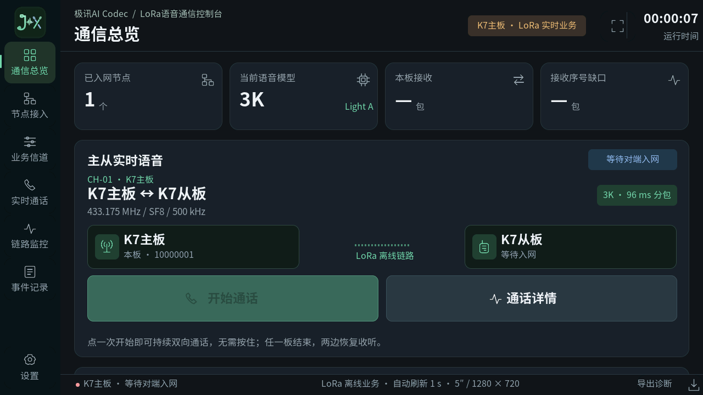
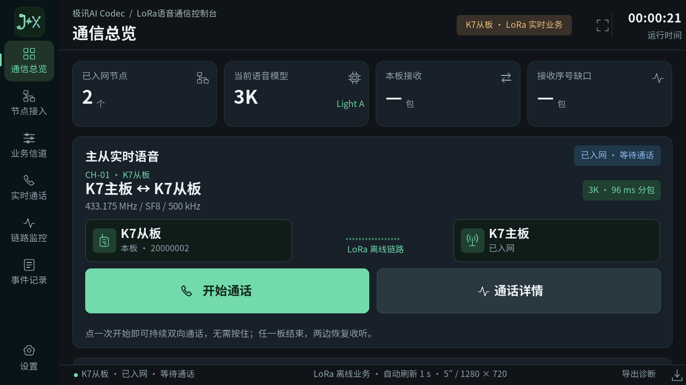

# K7 原生离线语音与原样式 UI 验证

记录日期：2026-11-04。本目录不包含登录凭据、原始会话、用户录音或构建二进制。量化摘要见 `validation-summary.json`。

## 实装版本与功能

| 角色 | 当前固件SHA256 | 大小 |
|---|---|---:|
| 主板A | `b44d8faa1b0d168f5dcde14e2ba8c9981eea293117c626c4e484be5b26da1fd0` | 2415632 B |
| 从板B | `4768df555c5034eaf64d00d8172114a5f9f340c7d7a41158ea300600800aeae0` | 2415632 B |

这里的A/B是业务角色；两个当前UI固件实际都在各自eMMC的A槽，已确认启动成功，B槽均保留较早语音回退。当前主从代码、权重和配置相同，仅角色启动命令和ROMFS CRC共6字节不同。

用户实际确认两板原极讯图标、布局、中文横屏和触摸切换正常；七页面自动导航通过。两板分别完整断电、上电后从eMMC自动启动UI与正确角色，并通过LoRa注册和对时；冷启动后界面通话复测通过。

截图来自实际帧缓冲，物理显示和真实触摸另由用户确认；没有将截图单独作为屏幕硬件验收依据。

## 当前 UI 通话

| 发起测试的本端 | 发送 | 接收 | 接收序号缺口 | 本端测得的LoRa SNR |
|---|---:|---:|---:|---|
| 从板，约半分钟 | 288 | 289 | 0 | 11.25～14.25 dB |
| 主板，约24秒 | 227 | 227 | 0 | 10.25～14.25 dB |

都通过界面按钮发起和结束，结束后恢复待机并重新注册。两行来自不同测试，不是同一轮双端同时采集；通话边界一包差不能直接当成丢包。

此前无UI的语音基线另通过一分钟测试：主板发604、收603，坏包、序号缺口、PLC、时隙跳过/发送失败和队列溢出均为0。该结果只属于该语音基线，不能冒充当前UI版的一分钟回归。

## 编解码与优化依据

相同模型和权重的原生计算基线约编码9.2 ms/24 ms音频、解码53 ms/96 ms音频；全业务平均解码约56～57 ms/96 ms。并发编码token摘要为 `7c5ab4afb3b67a3a`。

较早Linux/openVela混合链路对照中，原生接收解码相对Linux参考SNR为81.624/79.597 dB；反方向编码的48000个参考样点MSE=0。这是移植误差指标，不是Codec相对原始语音的质量，也不是LoRa射频SNR。Codec相对输入的SNR约5.23～5.29 dB、分段SNR约3.49～3.54 dB。没有把这组历史波形指标说成当前UI版重新采集的结果。

当前仓库整理修改构建接入与说明，清理生成资源注释中的本机路径，并统一Git文本LF行尾；权重数组和运行语句保持不变。新目录编译结果另写入 `build-validation.json`；新编译不代表重新上板测过，也不能用纯模型计算时间代替物理端到端延时。

## 已知问题

1. **偶发CPU1空闲栈标记改写尚未根治。** 首次UI通话曾报100%栈使用；实读为TLS上方32字节标记被改写，中部仍有大量未使用标记。相同固件重启后，正常通话、接通中取消、持续通话以及两板冷启动后检查未复现。不是已证实的统计误报，不宣称已修复。
2. USB数据枚举曾触发设备节点丢失，尚未根治。ADB未自动启动；目前使用独立电源和DEBUG串口。
3. Wi-Fi、以太网、蓝牙和实体MENU按键尚未移植；触屏控制和纯LoRa业务已实现。
4. 较早偶发eMMC冷启动识别问题尚未证明全部根治，本版两板冷启动已通过。原始启动分区被自动挂载流程当FAT尝试时有已知错误日志，没有格式化。
5. 音频仍为128 ms周期、512 ms总缓冲，尚未校准物理端到端延时。

功能验收通过的范围是显示/触摸、业务控制、LoRa语音和冷启动，不等同于所有长期内存稳定性问题已关闭。
